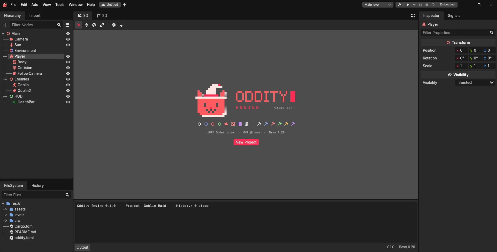
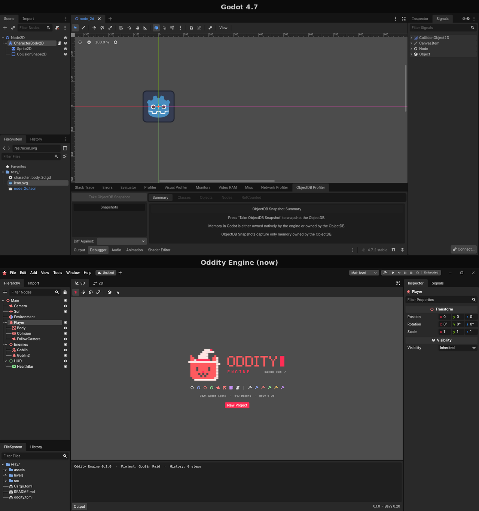

# Oddity Engine roadmap

*Updated 14 October 2026 · Phases 0–2 built · Phase 3 is next*

Oddity Engine, by Hex0ddity Labs, is a Godot-style editor for Bevy 0.20,
written in Rust, with a Unity-Hub-style launcher on top. It copies Godot's look,
layout and icons; underneath it is Bevy's ECS, and everything a game uses
compiles down to plain Bevy.


**The detailed plans**

| Document | What |
| --- | --- |
| [modularity.md](modularity.md) | Layers, the shape of a feature, the editor extension API, features in games (from Phase 3) |
| [commands.md](commands.md) | Commands every feature registers, undo per document, MCP, automation (from Phase 3) |
| [scripting.md](scripting.md) | Unity-style scripting, levels on disk, Play, physics: design and tasks (Phase 3) |
| [game-features.md](game-features.md) | Assets, animation, game UI, saving, export, 2D, navigation, particles (Phase 4) |
| [steam.md](steam.md) | Steam: achievements, lobbies, leaderboards, cloud saves (Phase 4, networking in 5) |
| [multiplayer.md](multiplayer.md) | Host/join, synced nodes and fields, RPCs, QUIC and Steam transports (Phase 5) |

**Contents**

1. [Where we are](#where-we-are)
2. [Vision and principles](#vision-and-principles)
3. [Architecture](#architecture)
4. [Repository layout](#repository-layout)
5. [Phases in detail](#phases-in-detail)
6. [Levels, prefabs and instances](#levels-prefabs-and-instances)
7. [Scripting](#scripting)
8. [Hub, CLI, MCP and plugins](#hub-cli-mcp-and-plugins)
9. [Widget library](#widget-library)
10. [Bevy features we depend on](#bevy-features-we-depend-on)
11. [Prerequisites](#prerequisites)
12. [Risks, open questions and licensing](#risks-open-questions-and-licensing)

---

## Where we are

The editor opens in Godot 4.7's layout and look, with real docks working on a
demo level. Every edit goes through undoable commands.



Side by side with Godot 4.7 at the same size. Sizes and colours were measured
from Godot, and a test keeps the theme's colours matched to it.



What works today:

- **Hierarchy:** the level's node tree with Godot's icons and relationship
  lines. Select (click, Ctrl+click, Shift+click), collapse, filter, show/hide
  with the eye, add (Ctrl+A) and delete (Delete).
- **Inspector:** the selected node's components in Godot's category bands,
  values read through reflection: Position, Rotation in degrees, Scale as x/y/z
  fields. Filterable. Read-only until Phase 3.
- **History:** every undo step, with undone steps dimmed. Click a step to jump
  back or forward to it.
- **FileSystem:** the open project's files, with Godot's icons and blue folders.
- **Viewport toolbar:** Select, Move, Rotate, Scale, local space and snap, on
  Godot's keys (Q, W, E, R, T, Y). The 3D/2D switch and distraction-free mode
  (Ctrl+Shift+F11). The 3D view itself arrives in Phase 3.
- **Window:** custom title bar with menus, level tab and picker, and a
  jackdaw-style play bar; resize from any edge.
- **Underneath:** command registry with undo/redo and a dirty flag, selection,
  `oddity.toml` projects, headless mode for tests, CLI and MCP.

## Vision and principles

- **Godot look, Bevy model.** Godot's dock layout, dark theme and MIT-licensed
  icons, with entities and components underneath. The Bevy you know keeps working.
- **One command layer.** Every action is a command. Menus, shortcuts, the CLI,
  MCP and plugins all call the same commands, which gives undo/redo everywhere.
- **Modular.** Every feature is its own set of crates, in checked layers.
  Built-in features enter the editor through the same API plugins will use,
  back ends are swappable, and games compile only the features they turn on.
  See [modularity.md](modularity.md).
- **Native Bevy UI.** Our own widget layer on Bevy's `bevy_ui_widgets` and
  Feathers, themed with Godot's palette.
- **Unity-style scripting in Rust.** Scripts are structs attached to nodes,
  with `_onready`, `_onprocess` and friends, Inspector fields, events and
  signals; plain Bevy systems work alongside. No built-in code editor: scripts
  open in VS Code or Zed. See [scripting.md](scripting.md).
- **The Hub for users, never required for development.** Debug builds,
  headless commands and `--no-hub` skip it.
- **Bevy 0.20 is the seed.** Pinned to exactly `0.20.0`. Each project pins its
  editor and Bevy version, and upgrades are deliberate.
- **Small steps.** Every phase ends in something that runs.

## Architecture

Two binaries share one workspace, and every way of changing a project goes
through the command layer in `oddity_core`.


The Hub reads a project's `oddity.toml`, then starts the matching editor
through the `oddity_launch` handoff. Inside the editor, the UI, CLI, MCP server
and plugins never touch the World directly; they run commands, so undo/redo,
scripting and AI control are one feature. Headless mode is the same editor with
`MinimalPlugins` and no window, used by the CLI, MCP and tests.

The level being edited lives under a `LevelRoot` entity in the same World as the
editor UI; anything outside it is editor, not level. Deleting disables entities
instead of despawning them, so undo brings back the very same entities.

## Repository layout

One Cargo workspace holds both apps and every crate, so the Hub and editor share
the widgets, project format and launch contract. Crates are created when a phase
needs them.

```
Oddity-engine/
├── Cargo.toml                 workspace root, pins bevy = "=0.20.0"
├── .cargo/config.toml         fast linking, `cargo editor` alias
├── .github/workflows/ci.yml   fmt, clippy, tests, Windows build
├── docs/                      architecture and code conventions
├── roadmap/                   this roadmap and its diagrams
├── branding/                  cat, wordmark, Hex0ddity mark, brand board
├── crates/
│   ├── oddity_icons/          Godot + @icons + brand SVGs, sharp at any scale   ✓
│   ├── oddity_widgets/        theme, fonts, docks, tree, fields, buttons         ✓
│   ├── oddity_core/           commands, undo/redo, selection, level root         ✓
│   ├── oddity_project/        oddity.toml format                                 ✓
│   ├── oddity/                what games depend on: prelude, oddity::run         Phase 3
│   ├── oddity_script/         scripts, Ctx, the runner, events, signals, timers  Phase 3
│   ├── oddity_script_macros/  #[script], #[listener], #[signal], #[on]           Phase 3
│   ├── oddity_level/          level and prefab files (JSON), overrides           Phase 3
│   ├── oddity_physics/        physics nodes and callbacks, engine-independent    Phase 3
│   ├── oddity_physics_rapier/ the Rapier backend                                 Phase 3
│   ├── oddity_physics_editor/ physics nodes in Add Node, shapes in the viewport  Phase 3
│   ├── oddity_build/          background cargo builds, compiler messages         Phase 3
│   ├── oddity_viewport/       editor camera, grid, gizmos, picking               Phase 3
│   ├── oddity_plugin_api/     editor registries: docks, menus, nodes, fields     ✓ v0 (public in 6)
│   ├── oddity_steam/          Steam: achievements, lobbies, leaderboards, cloud  Phase 4
│   ├── oddity_steam_editor/   Steam settings page                                Phase 4
│   ├── oddity_net/            multiplayer: sessions, sync, RPCs                  Phase 5
│   ├── oddity_net_quic/       the QUIC transport                                 Phase 5
│   ├── oddity_net_steam/      the Steam transport and lobbies                    Phase 5
│   ├── oddity_net_editor/     network nodes, multi-player Play                   Phase 5
│   ├── oddity_mcp/            MCP server: commands → tools                       ✓ v0 (v1 in 6)
│   ├── oddity_launch/         Hub ↔ editor handoff (public contract)             Phase 7
│   └── oddity_hub/            installs, version manifest, project registry       Phase 7
├── apps/
│   ├── editor/                oddity-editor binary                               ✓
│   ├── hub/                   oddity-hub binary: UI + CLI                        Phase 7
│   └── (games are separate projects; see samples/)
├── tools/xtask/               `cargo xtask layers`: checks the crate layers      Phase 3
├── samples/shooter/           the test game used while building scripting       Phase 3
├── templates/                 2d/ and 3d/ project templates                      Phase 7
├── third_party/               Godot icons and @icons, with their MIT licences    ✓
└── THIRD_PARTY_NOTICES.md
```

Every crate sits in a layer (runtime, tooling, extension, app) and may only
depend downwards; a feature's editor half is its own `_editor` crate. The rules
are in [modularity.md](modularity.md) and checked in CI.

Two crates are public contracts: `oddity_launch` (older editors must still
launch from a newer Hub) and `oddity_plugin_api` (third-party plugins depend on
it from Phase 6; before that it's internal and may change). Change them rarely
and version them.

## Phases in detail

No dates: they get set once the pace of Phase 3 is known. A first MCP server
(stdio, headless) is in Phase 3, right after the command work; see
[commands.md](commands.md#mcp).

### Phase 0 · Foundations ✓

*Done when an empty editor window opens and CI is green.*

- [x] Cargo workspace pinned to Bevy `=0.20.0`; fast linking; `cargo editor`
- [x] CI: fmt, clippy (`-D warnings`), tests, Windows build
- [x] Icons: 1,024 Godot icons and 642 @icons embedded as SVG, rendered by
      resvg at the exact size and screen scale; @icons tinted per node family
- [x] Theme: Godot 4.7's theme rules (base, accent, contrast) ported, with the
      Oddity hot-pink accent, fed into Feathers' tokens
- [x] Fonts: Inter, Space Grotesk, Geist Mono

### Phase 1 · Core ✓

*Done when commands run headless in tests, with undo.*

- [x] `EditorCommand` and `History`: undo/redo, a 500-step limit, a dirty flag
- [x] Commands: spawn, delete (disable), rename, reparent, set field, add and
      remove component, batch, selection
- [x] `CommandRegistry` with JSON arguments, ready for the CLI and MCP
- [x] Reflection to JSON for any component
- [x] `oddity.toml` projects: create, load, find, version check
- [x] `LevelRoot`: what is level and what is editor

### Phase 2 · Widgets and shell ✓

*Done when the layout looks like Godot's.*

- [x] Custom title bar: minimise, maximise, close, drag, edge resize
- [x] Top bar after jackdaw: menus, level tabs, level picker, play controls
- [x] Docks and Godot's bottom panel; resizable splits; distraction-free mode
- [x] Tree view: Godot's rows, relationship lines, row buttons, filtering
- [x] Search fields, tool buttons with toggle state, hover feedback
- [x] Hierarchy, Inspector (read-only), History, FileSystem, Output
- [x] Viewport toolbar state on Godot's keys
- [x] Godot 4.7 look, measured from screenshots and checked by a test

### Phase 3 · Editing (next)

*Done when you can make, save, reopen and play a level, and edit a prefab in
isolation.* This is where Oddity becomes a usable editor.

**Modularity and commands first** — tasks P1 to P4 in
[modularity.md](modularity.md#build-plan) and K1 to K6 in
[commands.md](commands.md#build-plan). Suggested order: P1, K1, K2, P2, K3,
K4, then P3 and P4 with their tracks; K5 before level tabs; K6 any time after K2.
- [x] P1 · The layer check: every crate declares its layer; `cargo xtask layers` in CI
- [x] K1 · Command kinds (edit, setting, action, query), examples, invocations; first queries
- [x] K2 · Every step records its source (you, CLI, MCP, plugin, script); `CommandExecuted`
- [x] P2 · `oddity_plugin_api` v0: window/headless modes, commands, dock tabs, menu items
- [x] K3 · One intention, one undo step: merging drags, `batch` by name, agent groups
- [x] K4 · The round-trip check: every command's do, undo and redo tested automatically
- [x] P3 · Node types registry and `node.create` (with the Nodes track below)
- [x] P4 · Inspector field registry (with the Inspector track below)
- [ ] K5 · One history per open level or prefab, plus one for project settings
- [x] K6 · MCP v0: stdio, headless, tools generated from the command registry

**Inspector**
- [ ] Editable fields: Feathers number and text inputs, checkboxes, dropdowns;
      dragging a number scrubs it; every change is one undo step; each field
      type registered through `oddity_plugin_api` (P4)
- [ ] Add Component and Remove Component
- [ ] Instance overrides shown in bold, with Apply and Revert

**Viewport**
- [ ] 3D view rendered to a texture inside the dock, with Godot's grid and sky
- [ ] Editor camera: orbit, pan, fly; frame selection (F)
- [ ] Click to select (`bevy_picking`), box select
- [ ] Gizmos for move, rotate and scale, honouring local space and snapping
- [ ] Editor-only objects on their own render layer, hidden from the game
- [ ] 2D view with Godot's rulers and canvas

**Levels and prefabs**
- [ ] Save and load `.level` and `.prefab` files (JSON) through `oddity_level`
- [ ] Level tabs and the level picker work for real; unsaved-changes prompt
- [ ] Prefab mode: its own tab, an isolated world, a breadcrumb
- [ ] Instances: place a prefab in a level, override values, Apply / Revert
- [ ] FileSystem: watch for changes, drag a prefab into the viewport or hierarchy

**Nodes**
- [x] Node registry: node types as component presets, each with its Godot icon,
      registered through `oddity_plugin_api` (P3)
- [ ] Add Node dialog with search and favourites
- [ ] Rename in place, drag to reparent, context menu, Copy Node Path,
      `%Unique` names

**Scripting, Play and physics** — the full task list is in
[scripting.md](scripting.md#build-plan), milestones A to G:
- [ ] A · The runtime: `#[script]`, the runner, `Ctx`, node references,
      events, signals, timers, input
- [ ] B · Level and prefab files
- [ ] C · The game program (`oddity::run`) and the project template
- [ ] D · The editor: background builds, script fields, references, New Script
- [ ] E · Play and Stop, with a live link to the running game
- [ ] F · Physics nodes and collision callbacks (Rapier)
- [ ] G · Sound, UI buttons, debug drawing

### Phase 4 · Game features

*Done when a small game can be made, saved, exported and shipped on Steam.*
The rough plan for each feature is in [game-features.md](game-features.md);
Steam's is in [steam.md](steam.md).

- [ ] Assets and importing: `.import` settings, glTF models, textures, audio,
      the Import dock, hot reload
- [ ] Materials (`.material` files) edited in the Inspector
- [ ] Animation: AnimationPlayer node, an Animation dock
- [ ] Game UI: Control nodes, layout in the 2D view, themes and fonts
- [ ] Moving between levels: loading screens, global nodes, additive levels
- [ ] Saving progress: save slots and prefs, Steam Cloud when enabled
- [ ] Exporting: Windows, Linux, macOS, Web
- [ ] Project features: Project Settings › Features turns the game's `oddity`
      Cargo features on and off; unused extensions hide (modularity P5)
- [ ] Steam: achievements, stats, overlay, lobbies, leaderboards, cloud saves
- [ ] 2D: the 2D view, sprites, 2D physics
- [ ] Navigation: navmeshes and agents
- [ ] Particles
- [ ] Hot-patching of code inside script callbacks (Bevy's `hotpatching`)

### Phase 5 · Multiplayer

*Done when two players can play a co-op level over Steam.* Design and tasks:
[multiplayer.md](multiplayer.md).

- [ ] Sessions: host, join, leave over QUIC; the NetworkManager node
- [ ] Networked nodes, NetworkTransform, networked prefabs
- [ ] `#[sync]` fields and RPCs
- [ ] Play with several players from the editor
- [ ] Steam transport and lobbies
- [ ] Dedicated server export

### Phase 6 · CLI, MCP and plugins

*Done when an agent and a sample plugin both edit a level.* MCP v0 (stdio,
headless) already exists from Phase 3.

- [ ] Editor CLI with `clap`: `run`, `build --target`, `plugin add`
- [ ] Command palette, command scripts (`oddity-editor run`, `--dry-run`) and
      History's *Copy as script* (commands K7)
- [ ] MCP v1: attach to an open editor over HTTP; an agent's edits show live
      and undo with Ctrl+Z (commands K8)
- [ ] `EditorPlugin` API v1: make `oddity_plugin_api` (in use internally since
      Phase 3) stable, versioned and documented; add asset importers and a
      sample plugin; plugins are Cargo dependencies

### Phase 7 · Hub

*Done when the Hub installs two editor versions and opens a project in each.*

- [ ] Launch handoff contract in `oddity_launch`; the editor refuses to start
      without the Hub except in dev, headless and `--no-hub`
- [ ] Hub CLI: `new`, `open`, `install`, `list`, `doctor` (Rust, the linker,
      and Microsoft's C++ Build Tools on Windows)
- [ ] Hub UI: projects, installs, modules (Rust targets), toolchain check
- [ ] Version manifest on GitHub Releases; verified downloads, side-by-side installs
- [ ] Project templates (2D, 3D)

### Later

- Prefab variants (a Goblin based on Enemy) and nested prefabs
- WASM plugins loaded at runtime with `wasmtime`, then a plugin browser
- Client-side prediction and rollback for competitive multiplayer
- The editor as an MCP client; MCP tools for the running game over the live link
- Embedded Play inside the viewport
- An audio mixer, localisation, modding, consoles, VR
- Hub extras: templates and plugin browser, news, self-update

## Levels, prefabs and instances

Oddity uses Unity's model with Unreal-style isolated editing instead of Godot's
single "scene" concept. Decided 14 October 2026.


| Concept | What it is | How you edit it |
| --- | --- | --- |
| **Level** (`.level`) | The world you play: terrain, lights, placed objects. Unity calls it a scene. | In the main viewport. Play runs the main level. |
| **Prefab** (`.prefab`) | A reusable object: Player, Enemy, Door. | Double-click to open in isolation: its own tab, an empty world with only the prefab, and a breadcrumb `Level ▸ Enemy`. Like Unity's Prefab Mode and Unreal's Blueprint editor. |
| **Instance** | A prefab placed in a level. | Change values in the Inspector. Changed values show in bold; Apply sends them to the prefab, Revert drops them. |

- **Both are JSON files**, written and read by `oddity_level`. Bevy 0.20 has
  BSN only as the `bsn!` macro (the `.bsn` file format isn't released), so the
  format is ours; [scripting.md](scripting.md#the-level-format) has the details.
- An instance stores only the prefab's path and its overrides, so changing the
  prefab updates every instance that didn't override that value.
- **Project file:** `[editor] main_level = "levels/main.level"` sets what Play runs.

## Scripting

Unity-style scripting, in Rust. A script is a struct attached to a node; a
node can have several; `pub` fields show in the Inspector; callbacks run in
Hierarchy order and their changes apply immediately. Plain Bevy systems run
alongside. The full design, API reference and build plan are in
**[scripting.md](scripting.md)**.

```rust
#[script]
pub struct Player {
    #[default(6.0)]
    pub speed: f32,              // in the Inspector, saved in the level
    pub bullet: Prefab,          // dragged in from the FileSystem
    cooldown: f32,               // private: runtime only
}

impl Script for Player {
    fn _onprocess(&mut self, ctx: &mut Ctx, delta: f32) {
        let movement = ctx.input().axis2("move");
        ctx.translate(Vec3::new(movement.x, 0.0, -movement.y) * self.speed * delta);

        self.cooldown -= delta;
        if ctx.input().action_pressed("fire") && self.cooldown <= 0.0 {
            self.cooldown = 0.25;
            ctx.instantiate(&self.bullet, ctx.global_transform());
        }
    }
}
```

The editor never contains or runs your code. Your game crate compiles in the
background; the editor learns your types from each build, so the Inspector
updates without a restart. Play runs your game as its own program with a live
link back to the editor.


Each frame, the runner calls scripts one at a time; your systems run in
parallel as usual.


## Hub, CLI, MCP and plugins

These reach the editor from outside its window, and all of them act through
the command layer.

**Hub (like Unity Hub).** A separate app in the same repo. It manages projects,
installed editor versions and build-target modules, then launches the editor
version each project pins.

**Launch handoff.** The Hub starts the editor with the project path, the Hub
version and a session token. Double-clicked directly, the editor shows "Open
this through Oddity Hub" with a launch button. Debug builds, headless commands
and `--no-hub` skip the Hub.

**CLI.** Both binaries parse arguments with `clap`:

```
oddity-hub install 0.3.0
oddity-hub list
oddity-hub new my_game --template 3d
oddity-hub open ./my_game                 # launches the pinned editor
oddity-hub doctor                         # checks Rust, linker, targets
oddity-editor ./my_game --no-hub          # direct start for development
oddity-editor run ./my_game
oddity-editor build ./my_game --target wasm32
oddity-editor plugin add <name>
oddity-editor mcp ./my_game               # MCP server over stdio
```

**MCP.** The editor runs an MCP server built with `rmcp`. It has no list of
its own: every registered command becomes a tool (queries marked read-only,
destructive actions marked destructive), so a new feature or plugin is usable
by agents the moment it registers its commands. Resources expose the level
tree, selection, history, node types, project files and logs. Agent edits are
labelled in History and undo like yours. Stdio for agents and CI (Phase 3),
HTTP to attach to an editor that's already open (Phase 6). Details in
[commands.md](commands.md#mcp).

**Plugins.** v1: Rust crate plugins through the `EditorPlugin` trait, listed as
Cargo dependencies (adding one means a rebuild). They use the same registries
Oddity's own features have used since Phase 3, so a plugin can do anything a
built-in feature can. v2: WASM plugins with
`wasmtime`, sandboxed and loaded at runtime, needed before a marketplace.

## Widget library

Our own take on `bevy_feathers`: Feathers' controls, themed with Godot's
palette, plus the editor-shaped widgets Feathers doesn't have.

| Widget | Source | Status |
| --- | --- | --- |
| Button, checkbox, radio, slider, toggle, colour picker | Feathers, themed | ✓ |
| Text input, number input | Feathers, themed | search fields ✓; number fields in Phase 3 |
| Menu, select, list view, dialog, scrollbar | Feathers, themed | Phase 3 |
| Docks, tabs and Godot's bottom panel | Ours | ✓ |
| Resizable splits | Ours | ✓ |
| Tree view (lines, row buttons, filter) | Ours | ✓; drag to reparent in Phase 3 |
| Tool buttons and toggles, hover feedback | Ours | ✓ |
| Tooltip, context menu | Ours, on Feathers popover | Phase 3 |
| Drag and drop | Ours | Phase 3 |

## Bevy features we depend on

| Bevy feature | Editor use | Phase |
| --- | --- | --- |
| ECS: components, resources, systems, queries, schedules | Everything | 0 ✓ |
| Assets, `embedded_asset` | Fonts and icons inside the binary; later the FileSystem watcher | 0 ✓, 3 |
| Observers and events | Widget actions, tree events, selection | 1 ✓ |
| Headless apps (`MinimalPlugins`) | CLI, MCP, tests without a window | 1 ✓ |
| Entity disabling | Undoable delete | 1 ✓ |
| Hierarchy: `ChildOf` / `Children` | The node tree and the UI | 2 ✓ |
| `bevy_ui`, BSN (`bsn!`), Feathers | Every panel | 2 ✓ |
| `bevy_input_focus`, `EditableText` | Keyboard focus, search fields, shortcuts | 2 ✓ |
| `bevy_picking` | UI clicks ✓, then viewport selection | 2 ✓, 3 |
| `bevy_reflect` (+ `reflect_auto_register`) | Inspector ✓, saving, finding scripts | 2 ✓, 3 |
| Reflection serialization | Level and prefab files (our JSON format) | 3 |
| Exclusive systems, `FixedUpdate`, messages | The script runner, signals | 3 |
| `bevy_remote` | Live link between the editor and the running game | 3 |
| `bevy_rapier3d` 0.37 (not Bevy itself) | Physics, behind our own nodes | 3 |
| Cameras, render-to-texture, render layers | Viewport inside a dock; editor-only objects | 3 |
| Gizmos | Grid, selection outlines, transform handles | 3 |
| States | Edit mode vs play mode | 3 |
| `hotpatching` | Code changes inside callbacks without restarting the game | 4 |
| `bevy_animation`, glTF, Bevy UI, Bevy audio | Animation, imported models, game UI, sound | 4 |
| `bevy_replicon` 0.45 + `bevy_replicon_quinnet` 0.21 (not Bevy itself) | Multiplayer replication and the QUIC transport | 5 |

## Prerequisites

| Need | Why |
| --- | --- |
| Rust 1.97.1 or newer (`rustup update`) | Bevy 0.20 requires it |
| VS Code, Zed or RustRover with rust-analyzer | Completion and inline errors; scripts open there |
| A fast linker (configured in `.cargo/config.toml`) | Bevy's default build times are slow |
| Godot 4.7 installed | Side-by-side visual reference; measure, don't eyeball |
| Bevy 0.20 release notes and migration guide | AI models may know older APIs; hand these over at the start of a session |

Knowledge: comfortable Rust (ownership, traits, generics), Bevy ECS basics
(components, systems, queries, observers), and flexbox for Bevy UI layout.

## Risks, open questions and licensing

| Risk | Mitigation |
| --- | --- |
| Bevy breaks APIs about every three months | Pinned to `=0.20.0`; upgrade only in a dedicated pass with the migration guide |
| AI suggestions target older Bevy APIs | Hand over the 0.20 notes at session start; feed compiler errors back; use Bevy's examples as reference |
| Level files need our own format (no `.bsn` files in 0.20) | Keep it small, versioned (`"version": 1`) and round-trip tested; it lives entirely in `oddity_level` |
| Instance overrides are hard | Store overrides as plain field paths; ship Apply/Revert before variants and nesting |
| The physics crate we use falls behind | Game code only sees our physics nodes; switching engines is a new backend plugin |
| Building your game takes time | Only your crate recompiles; Bevy is cached once per machine; hot-patching in Phase 4 |
| An undo that doesn't fully undo goes unnoticed for weeks | Every command carries an example, and one test runs do, undo and redo on all of them (commands K4) |
| Crates slowly tangle as features are added quickly | Layers declared per crate and checked by `cargo xtask layers` in CI; extensions can't depend on each other |
| Public contracts (launch, plugin API) drift | Version them; test that older editors still launch from the current Hub |
| A solo project loses momentum | Every phase ends in something that runs; keep each phase small |
| Third-party crates lag behind Bevy 0.20 (Hanabi, tilemaps, Lightyear, `bevy_steamworks` today) | Prefer libraries that don't depend on Bevy (`steamworks`, `landmass`) with our own thin wrappers; otherwise wait or port |

**Open questions**

- 2D, 3D or both in the first release
- Long-term hosting for editor builds beyond GitHub Releases
- Which code editor "Open script" defaults to, and how it's chosen
- When to move physics to Avian (once it supports Bevy 0.20), or stay on Rapier

**Settled:** name and logo (Oddity Engine by Hex0ddity Labs, wizard-cat mark);
Bevy 0.20 has text editing (`EditableText`, Feathers inputs); levels and
prefabs instead of scenes; Unity-style scripting (see [scripting.md](scripting.md)).

**Licensing.** Godot's code and editor icons are MIT-licensed; the SVGs and
Godot's licence live in `third_party/godot/` and are credited in
`THIRD_PARTY_NOTICES.md`. @icons by Voxybuns is MIT-licensed too. The Godot name
and logo are trademarks, so they are never used for Oddity's branding.
